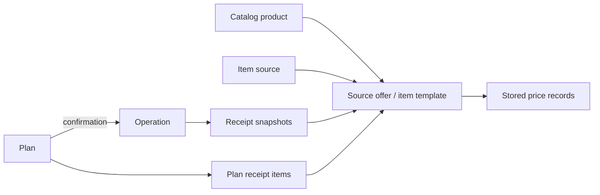

# Architecture

Reviewed against `e5eaee1` and the deployed reliability update `c86c196` on 2026-10-12. This document describes implemented behavior. Proposed receipt, catalog and analytics changes remain in [the product plan](RECEIPTS_AND_PRODUCT_ANALYTICS_PLAN.md); dated production findings are in [the operations review](OPERATIONS_REVIEW_2026-10-12.md).

## Runtime and boundaries

- FastAPI exposes one API to the browser and Telegram Mini App. SQLAlchemy repositories persist data in PostgreSQL 16; Alembic owns schema migrations.
- `app/api` handles HTTP transport, validation and dependency adaptation. `app/services` owns business workflows, `app/repositories` data access, `app/db/models` persistence and `app/schemas` API contracts.
- `tests/api/test_backend_boundary_guards.py` checks layer imports. Services and repositories do not depend on API handlers; the bot shell delegates mutations to service adapters.
- Docker Compose runs `app`, `bot`, `db` and optional `redis` under the `cache` profile. App startup runs migrations before Uvicorn; bot startup depends on app readiness. Redis supplies a cache, not a separately deployed job worker queue.
- `/health` is the lightweight liveness endpoint. `/ready` verifies database access and migration readiness. The bot healthcheck requires recent loop progress, a recent successful Telegram poll and a live worker process.
- `tests/test_migration_consistency.py` checks revision structure and metadata; complete PostgreSQL migration checks require a dedicated disposable `MIGRATION_TEST_DATABASE_URL`. Skipped database tests are not migration validation.

## Authentication and access

Telegram WebApp `initData` is the primary production login path. Browser Telegram login is optional and advertised by `/api/v1/auth/public-config` when `TELEGRAM_BOT_USERNAME` is configured. Google auth remains planned.

Provider identities in `auth_identities` resolve to one internal `users` record. Access states are `pending`, `approved` and `rejected`; admin Telegram identities are configured separately. `app/api/deps.py` adapts `auth_context_service` for authenticated, approved and admin access. `/api/v1/admin/*` uses service-level access governance. User removal is centralized in `user_cleanup_service` for both self-removal and admin removal.

## Frontend runtime

The frontend is plain server-served HTML/CSS/JS without a framework bundler. `static/index.html` loads the bootstrap, and `static/js/app-manifest.js` specifies the ordered inventory. `app-bootstrap.js` starts script loads concurrently with `Promise.all`; `script.async = false` preserves execution order. Asset versioning and entry-document caching behavior must remain compatible during releases.

| Boundary | Responsibility |
| --- | --- |
| `app-init-registry.js` | Registration of core, feature and startup initialization stages. |
| `app-runtime-registry.js` | Runtime modules, shared helpers and factory lookup. |
| `app-features.js` | Explicit, frozen public action facade for remaining cross-section navigation and orchestration. |
| Category actions and section/UI coordinators | Category-specific actions, grouped tables, pickers, collapse state and event dispatch. |
| Item catalog/product modules and coordinators | Product and source-offer data, rendering, selection, editing and linkage. |
| Analytics coordinators | Persisted view state, breakdown rendering, visibility and hover/focus coordination. |
| Operation and plan modal modules | Receipt editing, category/source pickers, preview, calculator and form lifecycle. |

Cross-module code should resolve the owning runtime module or a narrow dependency getter. Do not remove facade keys or compatibility fallbacks without a repository-wide consumer check, manifest-order verification and affected regressions. Module boundaries are protected by frontend contract tests.

Modals use the shared stack. The operation calculator participates in that stack; Escape closes the top eligible window, preserves the underlying operation draft and restores focus. Product and receipt redesign must preserve those contracts. UI rules live in [UI_SYSTEM.md](UI_SYSTEM.md) and [UX_PATTERNS.md](UX_PATTERNS.md).

## Operations, receipts and catalog

`OperationService` owns money-flow creation and edits. Operations retain currency and exchange-rate snapshots. The operation amount is authoritative for financial totals; receipt totals and discrepancies are exposed separately, and a discrepancy can be saved with a warning.

The current product relationship is:

- `catalog_products` holds the common product; `operation_item_templates` represents reusable source offers. Brands, sources, categories and images have their own records.
- `operation_receipt_items` stores purchase lines, including quantity, paid unit price, optional regular unit price, discount metadata and calculated line total. The current calculation rounds the unit price to money precision, then calculates `quantity * unit_price`; independent authoritative line totals are not implemented yet.
- `CatalogProductService` and `OperationItemTemplateService` own linkage, merging, separation and metadata synchronization. Category/brand changes can propagate to linked records under existing rules; not all historical product metadata is immutable.
- `operation_item_prices` is the existing price store. Receipt synchronization suppresses a price already present among up to 500 recent records; it is not a complete observation timeline. A discounted line contributes its known regular price, or no price if regular price is unknown. Paid discounted prices remain in receipt snapshots.
- Consequently, a return to a previous price can be omitted from this history. Do not document a guaranteed append on every purchase or infer complete price changes from these records.
- Template resolution batches names/source matches and price inserts to limit query growth. Optional product units, package variants, GTINs, website links, OCR and external product-price monitoring are planned, not implemented.

## Plans, debts, work and activity

- `PlanService` owns scheduling, confirmation, skipping, receipt linkage and repeat behavior. Confirming a plan creates the actual operation through domain services. Completed plans can be opened from operation source links, history and activity; explicit resumption preserves the same plan and its history, validates the next date and resynchronizes reminders.
- Debt counterparties aggregate individual lend/borrow debts and repayment entries. Outstanding balances and active/closed status derive from principal and repayments. Debt workflows are separate from expense/income categories. Telegram notifications concern due dates; immediate notifications after manual repayment are intentionally disabled.
- Work profiles, contracts, calendar days and payment links are handled by `WorkService`, `work_calendar` and `WorkEarningsService`. Salary estimates follow the salary cycle; actual earnings statistics follow payment dates and explicit/historical payroll linkage. Existing currency snapshots and base-currency separation are preserved.
- `ActivityService` exposes the activity/restore workflows. Changes to receipt fields and catalog linkage must include operation/plan edit, deletion and restoration paths.

## Telegram worker and background jobs

`scripts/run_telegram_admin_bot.py` runs long polling and periodic job scans in the same process. It calls Telegram service adapters for access-review callbacks, plan confirmation, plan/debt reminders, currency digests and currency alerts. Job claims and advisory locks prevent conflicting delivery work; `PlanService` remains the source of truth for financial confirmation.

Polling requests `message` and `callback_query`. `/start` uses the message handler; access-review and plan buttons use the callback handler. The `message` event can be non-textual, including Telegram service messages. Outgoing delivery responses are not routed into `handle_message`; a callback's embedded original bot message is handled within the callback path.

Network/HTTP failures in polling and failures of individual background scans have retry/logging paths. The reliability update skips empty/non-text messages and isolates each update with bounded retries. After a domain action returns successfully, only Telegram response delivery is retried; its failure must not replay the financial action. Exhausted failures are logged without message contents. Worker health requires both loop progress and a successful poll within five minutes, plus a live process. Docker health status reports failure; it does not itself restart or notify. These changes were deployed in `c86c196`; the September incident is documented in the operations review.

## Currency sources

`BankCurrencyRateRefreshService` fetches selected bank sources via individual adapters. Current channels are Priorbank online and Technobank, BSB and Sber cash. The nominal refresh interval is 15 minutes; staleness is 45 minutes. Provider-attempt throttling currently uses process-local state.

Successful quotes update current rates and historical snapshots, keeping scale, buy/sell direction, channel and observation timestamps. Failed providers log an error and do not stop other providers. Sber currently points to `developer.sber-bank.by`; DNS failure of that endpoint was verified on 2026-10-12. A supported replacement endpoint is not yet verified. The reliability update adds failure intervals of 15, 30, 60, 120, 240 and at most 360 minutes, reset after recovery. Explicit forced refresh bypasses throttling; state remains per process and resets on restart. Diagnostics distinguish DNS (when the exception chain retains it), network, timeout, HTTP status and invalid payload. Bank rates and product price observations are different domains.

## Analytics and caching

Implemented dashboard routes include summary, calendar/month, calendar/year, trend, highlights and positions. Commerce and currency views use related feature APIs. Current analytics tabs include calendar, structure, positions, prices/discounts, trends and currency; consolidation is planned after useful workflows have replacements. Calendar and structure remain in place.

`app/core/cache.py` provides user-scoped namespaces `dashboard_summary`, `dashboard_analytics`, `plans`, `item_templates`, `debts`, `operations` and `categories`. Redis is optional; in-process fallback supports the small single-process deployment. Mutations invalidate the relevant namespaces. Cache availability and local-fallback pressure are observable; failed requests must not become valid zero results.

## Observability and recovery

API responses carry `X-Request-ID`; completion logs include method, path, status, duration and request ID. Domain and bot services emit structured events; `app/core/metrics.py` tracks HTTP totals. The worker health file contains process ID and progress/poll timestamps only. Restart-burst and external notification delivery still require monitoring integration.

`scripts/backup_postgres.sh` makes a custom PostgreSQL dump, encrypts it and uploads it through rclone, then applies remote retention. The wrapper delegates to `scripts/backup_queue.py`: a private encrypted retry spool, exclusive run lock, bounded commands, seven-day/512 MiB default queue, and separate creation/upload/retention statuses. Uploaded copies retain the existing 30-day policy. `check_backup_health.py` checks the age of the snapshot, not merely upload time, with a 36-hour default threshold. A successful restore remains a separate check. These scripts are deployed; the real upload check still received HTTP 410 and correctly retained an encrypted archive. This does not restore external provider availability. `scripts/verify_postgres_restore.sh` downloads/decrypts a selected backup and restores it into a separately named temporary database in the existing DB service. It checks for public tables; it is not full application/data validation or a completely separate PostgreSQL server.

Deployment and restore conditions are in [RELEASE_CHECKLIST.md](RELEASE_CHECKLIST.md) and [VPS_UPDATE_CHECKLIST.md](VPS_UPDATE_CHECKLIST.md). Production snapshots must include timestamps; a completed implementation milestone does not prove that the last backup or delivery succeeded.

## Documentation and generated graph

The existing `.understand-anything/knowledge-graph.json` metadata is dated 2026-08-05 at `e98e731`; it is 67 commits behind this review baseline. Treat it as historical navigation and verify each relevant link in current code. A full graph refresh remains a separate planned task; this documentation update does not falsely mark it current.

Update the affected behavior/architecture document alongside code changes. Keep future features in the roadmap until implemented, and retain graph commit, generation date and scope when rebuilding the derived graph.
