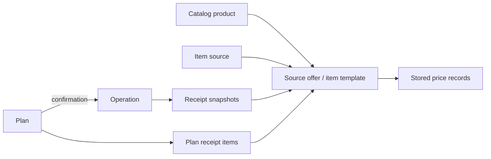

# Architecture

Reviewed on 2026-10-12, including reliability, keyboard search, optional purchase measurements, exact line discounts and comparable purchase metrics and the product workspace (stage 3, updated 2026-10-13). Release status is recorded in the roadmap. This document describes implemented behavior. Proposed receipt, catalog and analytics changes remain in [the product plan](RECEIPTS_AND_PRODUCT_ANALYTICS_PLAN.md); dated production findings are in [the operations review](OPERATIONS_REVIEW_2026-10-12.md).

## Runtime and boundaries

- FastAPI exposes one API to the browser and Telegram Mini App. SQLAlchemy repositories persist data in PostgreSQL 16; Alembic owns schema migrations.
- `app/api` handles HTTP transport, validation and dependency adaptation. `app/services` owns business workflows, `app/repositories` data access, `app/db/models` persistence and `app/schemas` API contracts.
- `tests/api/test_backend_boundary_guards.py` checks layer imports. Services and repositories do not depend on API handlers; the bot shell delegates mutations to service adapters.
- Docker Compose runs `app`, `bot`, `db` and optional `redis` under the `cache` profile. App startup runs migrations before Uvicorn; bot startup depends on app readiness. Redis supplies a cache, not a separately deployed job worker queue.
- `/health` is the lightweight liveness endpoint. `/ready` verifies database access and migration readiness. The bot healthcheck requires recent loop progress, a recent successful Telegram poll and a live worker process.
- `tests/test_migration_consistency.py` checks revision structure and metadata; complete PostgreSQL migration checks require a dedicated disposable `MIGRATION_TEST_DATABASE_URL`. Skipped database tests are not migration validation.

## Authentication and access

Telegram WebApp `initData` is the primary production login path. Browser Telegram login is optional and advertised by `/api/v1/auth/public-config` when `TELEGRAM_BOT_USERNAME` is configured. Google auth remains planned.

Provider identities in `auth_identities` resolve to one internal `users` record. Access states are `pending`, `approved` and `rejected`; admin Telegram identities are configured separately. `app/api/deps.py` adapts `auth_context_service` for authenticated, approved and admin access. `/api/v1/admin/*` uses service-level access governance. User removal is centralized in `user_cleanup_service` for both self-removal and admin removal.

## Frontend runtime

The frontend is plain server-served HTML/CSS/JS without a framework bundler. `static/index.html` loads the bootstrap, and `static/js/app-manifest.js` specifies the ordered inventory. `app-bootstrap.js` starts script loads concurrently with `Promise.all`; `script.async = false` preserves execution order. Asset versioning and entry-document caching behavior must remain compatible during releases.

| Boundary | Responsibility |
| --- | --- |
| `app-init-registry.js` | Registration of core, feature and startup initialization stages. |
| `app-runtime-registry.js` | Runtime modules, shared helpers and factory lookup. |
| `app-features.js` | Explicit, frozen public action facade for remaining cross-section navigation and orchestration. |
| Category actions and section/UI coordinators | Category-specific actions, grouped tables, pickers, collapse state and event dispatch. |
| Item catalog/product modules and coordinators | Product and source-offer data, rendering, selection, editing and linkage. |
| Analytics coordinators | Persisted view state, breakdown rendering, visibility and hover/focus coordination. |
| Operation and plan modal modules | Receipt editing, category/source pickers, preview, calculator and form lifecycle. |

Cross-module code should resolve the owning runtime module or a narrow dependency getter. Do not remove facade keys or compatibility fallbacks without a repository-wide consumer check, manifest-order verification and affected regressions. Module boundaries are protected by frontend contract tests.

Modals use the shared stack. The operation calculator participates in that stack; Escape closes the top eligible window, preserves the underlying operation draft and restores focus. Product and receipt redesign must preserve those contracts. UI rules live in [UI_SYSTEM.md](UI_SYSTEM.md) and [UX_PATTERNS.md](UX_PATTERNS.md).

## Search

`app/core/search.py` and `static/js/app-search-utils.js` share a literal substring contract: original query first, RU→EN and EN→RU keyboard variants, lowercase, collapsed whitespace and ё/е equivalence. Query correction never changes input or stored product/source identities. Pure numbers and punctuation do not trigger layout conversion. This is not typo correction, transliteration or independent correction of each word in a mixed-layout phrase.

`app/repositories/search.py` applies equivalent SQL expressions and relevance **before pagination**, including related offer/brand/category matches. Operation search uses independent user-scoped receipt operation-ID sets to avoid expensive correlated plans during relevance sorting. PostgreSQL uses a single bound literal regex per field, with explicit letter-case classes (including Cyrillic under C locale); whitespace and ё/е are handled in the pattern. SQLite registers a connection-local matcher because its built-in lower() is ASCII-only. `%`, `_` and backslash are literal search characters. No schema migration or database extension is required. Patterns are prepared once per query instead of repeatedly normalizing each database value; larger catalogues may need measured indexing work later.

Local tables/pickers use `App.search`; existing ordering is retained within relevance groups. Grouped tables retain their groups. Highlighting finds spans in the original text and escapes each span before inserting markup. The unified money-flow view must not discard repository hits by re-filtering only the short displayed operation title. Frontend releases change asset versions in both index and bootstrap, since versioned assets are cached as immutable.

## Operations, receipts and catalog

`OperationService` owns money-flow creation and edits. Operations retain currency and exchange-rate snapshots. The operation amount is authoritative for financial totals; receipt totals and discrepancies are exposed separately, and a discrepancy can be saved with a warning.

The current product relationship is:

- `catalog_products` holds the common product; `operation_item_templates` represents reusable source offers. Brands, sources, categories and images have their own records.
- `operation_receipt_items` stores purchase lines, including quantity, paid unit price, optional regular unit price, discount metadata and calculated line total. Legacy rows round unit price to money precision before multiplication. Explicit discount modes retain an authoritative paid line total; see the exact line discount contract below.
- Optional `sale_unit`, `package_quantity` and `package_unit` live on products (defaults) and independently on operation/plan receipt rows (snapshots). Units are piece/pack/kg/g/l/ml; package content uses piece/kg/g/l/ml, with a positive quantity up to three decimal places and a sale unit of piece/pack. Catalog edits do not propagate these fields to past purchases or plans. Plan confirmation, operation editing, deletion and restoration preserve the snapshot. Missing legacy data remains null; the server does not infer it from a product name or today's catalog defaults.
- Receipt/product forms expose measurements in an optional disclosure. Known receipt rows initially show a compact summary and inline money controls; «Изменить» exposes the original optional editors. Selecting a product can seed a new untouched receipt row; loading a saved row preserves its own values, including unknown units. A stale client replacing a measured receipt without measurement fields is rejected instead of erasing them. Products with different measurement defaults cannot be merged until explicit package variants are implemented. Separation copies defaults to the new card and preserves purchase snapshots.
- Migration `20261012_0046` adds nine nullable columns without a data backfill. It does not change money calculations or existing price-history semantics. Comparable quantity analytics now use these snapshots. Normalized price comparisons and package variants remain subsequent steps; never treat legacy aggregate quantity as comparable mass/volume.
- `CatalogProductService` and `OperationItemTemplateService` own linkage, merging, separation and metadata synchronization. Category/brand changes can propagate to linked records under existing rules; not all historical product metadata is immutable.
- `operation_item_prices` is the existing price store. Receipt synchronization suppresses a price already present among up to 500 recent records; it is not a complete observation timeline. A discounted line contributes its known regular price, or no price if regular price is unknown. Paid discounted prices remain in receipt snapshots.
- Consequently, a return to a previous price can be omitted from this history. Do not document a guaranteed append on every purchase or infer complete price changes from these records.
- Template resolution batches names/source matches and price inserts to limit query growth. Optional product units are implemented; package variants, GTINs, website links, OCR and external product-price monitoring remain planned.

### Product workspace (stage 3)

`app-catalog-product-details.js` owns tab state and read-only price/purchase loading inside the existing product modal. Product forms, staged images and offer management remain owned by `catalog-products` and `catalog-media`; tab changes do not rebuild their inputs. Product table rows retain selection, offer expansion and one name entry point, with measurement information replacing action buttons. Linked offer/receipt card entry points route to the same workspace; legacy unlinked offers still use their editor.

The default Prices view now derives complete purchase observations through `GET /operations/catalog-products/{product_id}/price-observations?template_id=…`. The separate saved-offer-price mode retains its legacy API (last 200 records, limit visibly stated). Price deletion retains confirmation, invalidates dependent caches and refreshes source/product views without changing saved receipts. Purchases use the existing user-scoped money-flow API with product/optional offer filters, no current-section date/search filters, and explicit 50-row pagination. Displayed sums are labelled as whole operations. Request cancellation and generation guards prevent stale context updates. A nested edit cannot replace an already open edit draft. Product/receipt metadata propagation rules and all financial calculations remain unchanged; no migration is required.

### Purchase price observations (stage 4a, 2026-10-13)

`ProductPriceHistoryService` reads actual expense receipt rows joined to operations, scopes both rows and the selected product/offer to the current user, and orders by purchase date, operation ID and row ID. Every surviving row is an observation, including repeats; there is no historical write, deduplication or limit of 200. Plans, legacy saved offer prices and website quotes are excluded. Normal edits, deletes, restores, offer detach and product merges are reflected on the next read through existing receipt/offer links. Identity/variant records and external observations remain stage 4b/6 work.

Paid price uses the exact stored line total divided by purchased quantity. Regular price requires the explicit receipt `regular_unit_price`, including for legacy rows; missing values are not inferred. Series separate currency and receipt shop snapshot. Unit mode additionally separates sale unit and package snapshot; normalized mode converts g/kg and ml/l to kg/l and packaged contents to kg/l/pieces. Missing package information excludes an unmeasurable pack from normalization; null sale units remain explicitly unknown in unit mode. Package changes in a normalized series are marked as changes, not confirmed shrinkflation. Percentages are Decimal ratios from the preceding comparable row and first/last row, never summed; a zero baseline yields null percent. Nonpositive quantities and negative totals are excluded. Date filters are inclusive and apply before summary calculation.

`app-catalog-price-history.js` renders the stepped chart and receipt links inside the product workspace. Horizontal steps represent ordered receipt positions, not equal calendar durations. The API returns complete observations for one offer, while the event list renders 50 at a time; currencies/measurement groups use an explicit series selector. Comparison/date controls are collapsible. The shared request generation guard rejects old responses; an edited nested receipt reloads the history, while simply returning preserves its current series. This iteration requires no DB migration, historical rewrite or off-host data transfer.

### Exact line discount contract (`20261012_0047`)

- `app/core/receipt_pricing.py` owns deterministic line arithmetic. `discount_mode` is nullable (`amount`, `percent`, `final`); `discount_value` stores currency amounts to two decimals or percentage to four. `discount_type` remains the independent promo/coupon/loyalty reason.
- With a new mode, `regular_unit_price` is the explicitly known original price, `line_subtotal = ROUND_HALF_UP(quantity × regular_unit_price, 2)`. Amount subtracts the fixed discount; percent first rounds the discount amount to cents, then subtracts it. Final stores the entered paid total and retains it when quantity changes. Final may omit regular price/subtotal; never infer them from catalog history. All new paid totals must be positive; a discount cannot exceed its known subtotal. Free lines/whole-receipt discount allocation are outside this change.
- Backend derives `unit_price = line_total / quantity` at six decimals (`Numeric(18,6)`). Incoming unit price remains required for compatibility but is not authoritative in new modes. It must never reconstruct the paid line total. Client `line_subtotal`/`line_total` are ignored on input: the server computes them from the explicit mode/value; legacy null-mode lines retain their previous two-decimal price calculation.
- Operations, plan snapshots/confirmation, delete/restore and activity preserve the new fields. Stale receipt replacements lacking explicit mode/value keys are rejected when any existing line uses new pricing. New clients send both keys, including null to intentionally revert to legacy mode; unrelated PATCHes remain compatible.
- `static/js/app-receipt-pricing.js` uses integer cents/thousandths for matching previews. Receipt sum, operation preview and FX funding use that calculation. Discount analytics use stored subtotal/paid total for new lines and preserve legacy behavior for old ones. Unknown regular prices contribute no guessed savings.
- Migration adds six nullable columns and widens only receipt/plan unit-price precision, with no historical backfill/recalculation. Downgrade refuses if new-mode rows exist. Old application images do not preserve the new semantics when replacing rows: after usage, prefer a forward fix or compatibility-patched rollback; do not deploy an unpatched old writer against these rows.

## Plans, debts, work and activity

- `PlanService` owns scheduling, confirmation, skipping, receipt linkage and repeat behavior. Confirming a plan creates the actual operation through domain services. Completed plans can be opened from operation source links, history and activity; explicit resumption preserves the same plan and its history, validates the next date and resynchronizes reminders.
- Debt counterparties aggregate individual lend/borrow debts and repayment entries. Outstanding balances and active/closed status derive from principal and repayments. Debt workflows are separate from expense/income categories. Telegram notifications concern due dates; immediate notifications after manual repayment are intentionally disabled.
- Work profiles, contracts, calendar days and payment links are handled by `WorkService`, `work_calendar` and `WorkEarningsService`. Salary estimates follow the salary cycle; actual earnings statistics follow payment dates and explicit/historical payroll linkage. Existing currency snapshots and base-currency separation are preserved.
- `ActivityService` exposes the activity/restore workflows. Changes to receipt fields and catalog linkage must include operation/plan edit, deletion and restoration paths.

## Telegram worker and background jobs

`scripts/run_telegram_admin_bot.py` runs long polling and periodic job scans in the same process. It calls Telegram service adapters for access-review callbacks, plan confirmation, plan/debt reminders, currency digests and currency alerts. Job claims and advisory locks prevent conflicting delivery work; `PlanService` remains the source of truth for financial confirmation.

Polling requests `message` and `callback_query`. `/start` uses the message handler; access-review and plan buttons use the callback handler. The `message` event can be non-textual, including Telegram service messages. Outgoing delivery responses are not routed into `handle_message`; a callback's embedded original bot message is handled within the callback path.

Network/HTTP failures in polling and failures of individual background scans have retry/logging paths. The reliability update skips empty/non-text messages and isolates each update with bounded retries. After a domain action returns successfully, only Telegram response delivery is retried; its failure must not replay the financial action. Exhausted failures are logged without message contents. Worker health requires both loop progress and a successful poll within five minutes, plus a live process. Docker health status reports failure; it does not itself restart or notify. These changes were deployed in `c86c196`; the September incident is documented in the operations review.

## Currency sources

`BankCurrencyRateRefreshService` fetches selected bank sources via individual adapters. Current channels are Priorbank online and Technobank, BSB and Sber cash. The nominal refresh interval is 15 minutes; staleness is 45 minutes. Provider-attempt throttling currently uses process-local state.

Successful quotes update current rates and historical snapshots, keeping scale, buy/sell direction, channel and observation timestamps. Failed providers log an error and do not stop other providers. Sber currently points to `developer.sber-bank.by`; DNS failure of that endpoint was verified on 2026-10-12. A supported replacement endpoint is not yet verified. The reliability update adds failure intervals of 15, 30, 60, 120, 240 and at most 360 minutes, reset after recovery. Explicit forced refresh bypasses throttling; state remains per process and resets on restart. Diagnostics distinguish DNS (when the exception chain retains it), network, timeout, HTTP status and invalid payload. Bank rates and product price observations are different domains.

## Analytics and caching

Implemented dashboard routes include summary, calendar/month, calendar/year, trend, highlights and positions. Commerce and currency views use related feature APIs. Current analytics tabs include calendar, structure, positions, prices/discounts, trends and currency; consolidation is planned after useful workflows have replacements. Calendar and structure remain in place.

`DashboardAnalyticsPositionsService.summarize_period` is shared by positions and the dashboard frequent-products widget. The repository groups paid expense receipt rows by operation, product/offer, currency and measurement snapshot in one query. Unique operation-ID sets count a product once per receipt, and count receipts once across the whole summary. Income rows and unconfirmed plans are excluded. Product grouping spans source offers; legacy unlinked rows retain their fallback identity. Frequency ties use product name, not mixed quantities or currencies.

`app/core/purchase_quantities.py` separately accumulates sale pieces, packages, kilograms, litres and pieces inside packages. Package contents multiply the snapshot quantity; grams/millilitres normalize to kg/l. Decimal arithmetic preserves up to nine fractional places. Unknown units and missing package contents have coverage counters and are never guessed from current catalog metadata. `amount_totals` sums authoritative paid line totals by original receipt currency; this is receipt spending, which can differ from operation totals. No exchange-rate conversion or cross-currency sum is used in the new UI. Legacy `quantity_total` and `amount_total` fields remain for API compatibility only.

`app-purchase-metrics.js` formats these metrics. Positions defaults to receipt frequency and offers separate unit metrics plus an explicit currency selector for spending. Dashboard «Чаще всего покупали» uses the same receipt count and canonical product drilldown. Old untyped quantity preferences migrate to frequency; price/discount redesign remains a later stage. Discount-product/type/timeline purchase counts also deduplicate receipt IDs. Cache keys for positions/highlights add `quantities-v1` within the existing user namespace; normal mutation invalidation still applies. This release requires no schema migration or historical writes.

`app/core/cache.py` provides user-scoped namespaces `dashboard_summary`, `dashboard_analytics`, `plans`, `item_templates`, `debts`, `operations` and `categories`. Redis is optional; in-process fallback supports the small single-process deployment. Mutations invalidate the relevant namespaces. Cache availability and local-fallback pressure are observable; failed requests must not become valid zero results.

## Observability and recovery

API responses carry `X-Request-ID`; completion logs include method, path, status, duration and request ID. Domain and bot services emit structured events; `app/core/metrics.py` tracks HTTP totals. The worker health file contains process ID and progress/poll timestamps only. Restart-burst and external notification delivery still require monitoring integration.

`scripts/backup_postgres.sh` makes a custom PostgreSQL dump, encrypts it and uploads it through rclone, then applies remote retention. The wrapper delegates to `scripts/backup_queue.py`: a private encrypted retry spool, exclusive run lock, bounded commands, seven-day/512 MiB default queue, and separate creation/upload/retention statuses. Uploaded copies retain the existing 30-day policy. `check_backup_health.py` checks the age of the snapshot, not merely upload time, with a 36-hour default threshold. A successful restore remains a separate check. These scripts are deployed; the real upload check still received HTTP 410 and correctly retained an encrypted archive. This does not restore external provider availability. `scripts/verify_postgres_restore.sh` downloads/decrypts a selected backup and restores it into a separately named temporary database in the existing DB service. It checks for public tables; it is not full application/data validation or a completely separate PostgreSQL server.

Deployment and restore conditions are in [RELEASE_CHECKLIST.md](RELEASE_CHECKLIST.md) and [VPS_UPDATE_CHECKLIST.md](VPS_UPDATE_CHECKLIST.md). Production snapshots must include timestamps; a completed implementation milestone does not prove that the last backup or delivery succeeded.

## Documentation and generated graph

The existing `.understand-anything/knowledge-graph.json` metadata is dated 2026-08-05 at `e98e731`; it is 67 commits behind this review baseline. Treat it as historical navigation and verify each relevant link in current code. A full graph refresh remains a separate planned task; this documentation update does not falsely mark it current.

Update the affected behavior/architecture document alongside code changes. Keep future features in the roadmap until implemented, and retain graph commit, generation date and scope when rebuilding the derived graph.
